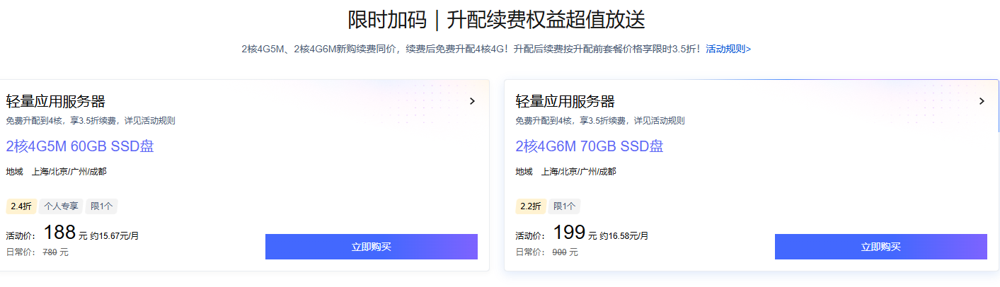

> 先说结论：今年双 11 腾讯云轻量有两场值得看的活动——「买一年送 3 个月」（2核2G 99 元、2核4G 188 元）和「限时加码：免费升配 4 核 + 3.5 折续费」。要长持的人走第二条：188 元新购 2核4G，0 元升配到 4 核，之后每年 273 元续费，4 核机器的年均成本能压到 250 元出头。活动截止 2026 年 11 月 30 日 23:59:59，售完即止。

年中写过[第一台服务器怎么买最省](https://www.ya0.cn/archives/tencent-cloud-buying-guide)和[六周年活动的实测](https://www.ya0.cn/archives/tencent-cloud-lighthouse-6th-anniversary)，评论区好几个读者在等双 11 的窗口——确实，双 11 是云服务器一年里优惠密度最高的时段。这次把轻量应用服务器两场活动的规格、价格和适合人群整理成一篇，顺便把长持成本这笔账算透。文中的活动链接是我的推广链接，通过它下单价格不变，我会有少量佣金。

## 一、买一年送 3 个月：首单首选

价格最直白的一场，四档规格直接按折扣排：

型号| 活动价| 折扣| 折合月均| 日常价  
---|---|---|---|---  
轻量 2核2G4M| 99 元/年| 1.7 折| ≈8.25 元/月| 576 元  
轻量 2核4G5M| 188 元/年| 2.4 折| ≈15.67 元/月| 780 元  
轻量 4核8G12M| 880 元/年| 3.2 折| ≈73.33 元/月| 2760 元  
轻量 8核16G18M| 1800 元/年| 3 折| ≈150 元/月| 6900 元  
  
怎么选：**2核2G** 放静态博客、轻量应用、跑个脚本完全够；**2核4G5M 188 元这档是个人建站最甜的配置** ，WordPress 加小程序后端很稳，也是我推荐大多数人的第一台；4核8G 往上就是正经业务配置了。专区里除了轻量还有云服务器 CVM 的标签页，规格可以按需挑。

专区入口：[买一年送 3 个月专区](https://curl.qcloud.com/1evh3DiK)。注意两条规则：**本专区商品不支持退款** ，下单前把配置和地域确认好；续费要在下单两小时之后才能操作。

## 二、限时加码：0 元升配 4 核 + 3.5 折续费，长持党的一场

这场是我觉得真正有意思的组合：「2核4G5M」和「2核4G6M」两个型号新购续费同价，参加活动后可以**免费升配到 4 核** ，升配后续费按升配前套餐价再打**限时 3.5 折** ，并且**可以多次续费** ：

新购套餐| 活动价| 升配后| 续费价（3.5 折）| 日常续费价  
---|---|---|---|---  
2核4G5M| 188 元/年（2.4 折）| 4核4G5M| 273 元/年| 700 元  
2核4G6M| 199 元/年（2.2 折）| 4核4G6M| 315 元/年| —  
  
升配在控制台一键完成，实例配置直接变成 4核4G / 60GB SSD / 500GB 月流量 / 5Mbps 带宽，数据不用迁移；实例上会挂一个「专享续费 3.5 折优惠」的标识，续费页里勾选「同意使用限时续费权益」后，续 1 年只要 273 元（划线价 700 元）。限时加码入口：[**升配续费权益超值放送**](https://curl.qcloud.com/5kd7HvAP)，同机型的秒杀入口：[**腾讯轻量双 11 秒杀**](https://curl.qcloud.com/nJu2g63p)。

把长持成本算成一笔账（以 2核4G5M → 4核4G5M 为例）：

年份| 操作| 支出| 手里是什么  
---|---|---|---  
第 1 年| 新购 2核4G5M| 188 元| 2核4G  
第 1 年内| 免费升配| 0 元| 4核4G  
第 2~4 年| 3.5 折续费 ×3| 273 元/年| 4核4G  
合计| —| ≈1007 元| 4核4G 用 4 年，年均约 252 元  
  
一台 4 核服务器的年均成本压到 250 元出头，除老用户的周年庆折扣外，这基本是能拿到的最低长持价格。

## 三、三种人三种买法

  * **年抛党（只打算用一年）：** 直接蹲首单价，188 元的 2核4G 就是目的地，不用纠结升配——反正一年后就还了。

  * **长持党（一用三五年）：** 走「新购 2核4G（188/199 元）→ 免费升配 4 核 → 3.5 折续费（273/315 元/年，可多次）」的完整组合，这是本篇的核心玩法。

  * **重负载（数据库/小程序后端/多服务）：** 直接看 4核8G12M 880 元/年（3.2 折）和 8核16G18M 1800 元/年（3 折），买赠专区里都有。

需要 AI 应用部署思路的可以配合[《AI 焕新：上云还是自己部署》](https://www.ya0.cn/archives/ai-huanxin-cloud-vs-selfhosted)一起看；手里有阿里云的也可以对比下[阿里云 99 元计划的续费账](https://www.ya0.cn/archives/aliyun-99-ecs-extended-2029)，两家加起来一年也就几百块。

## 四、下单前注意的四个点

  1. **买赠专区不支持退款：** 下单前确认配置和地域，选错只能认，这和平时随手买的按量实例不一样。

  2. **续费要在下单两小时后：** 想锁定续费权益的，别在下单页面死等，两小时后再回来操作。

  3. **个人专属、限购 1 台：** 活动价面向个人认证用户，每档限购一台，企业认证不适用。

  4. **升配不丢数据：** 升配是控制台原地操作，配置直接变更，不需要迁移和重装。

## 常见问题

### 3.5 折续费可以续几年？

活动期内可以多次续费，每次一年。具体能续到哪一年以活动页规则为准，按今年的活动周期，把未来两三年锁在这个价是没问题的——这也是长持玩法成立的前提。

### 只买一年，有必要升配吗？

有必要，而且强烈建议。升配是 0 元的，4 核的性能白拿一年，第二年不想要就不续，没有任何成本。唯一要注意的是升配后实例规格变了，别按 2核4G 的配置去评估负载。

### 升配后 5M 带宽和流量变吗？

不变。升的是 CPU 和内存（2核4G → 4核4G），带宽 5M、月流量 500GB、系统盘 60GB 保持原样，续费价也按升配前套餐价打 3.5 折。

### 这个价和新用户首购价冲突吗？

188/199 元本身就是首购活动价，新老用户的同价续费权益见活动页说明。已有轻量服务器的老用户，可以对照[六周年那篇的续费玩法](https://www.ya0.cn/archives/tencent-cloud-lighthouse-6th-anniversary)算一下哪个更划算再下手。

## 写在最后

双 11 的云服务器优惠一年就这几波。需要新购或续费的，建议在 11 月 30 日截止前把配置和续费年限算清楚再下手：[**买一年送 3 个月专区**](https://curl.qcloud.com/1evh3DiK)、[**限时加码：免费升配 + 3.5 折续费**](https://curl.qcloud.com/5kd7HvAP)。价格与活动规则以官方页面实时显示为准。

买完不知道练什么？[《第一台腾讯云服务器怎么买最省》](https://www.ya0.cn/archives/tencent-cloud-buying-guide)里的下单顺序、[《一行代码自动续签 SSL 证书》](https://www.ya0.cn/archives/ssl-updata)都是现成的上手内容。
