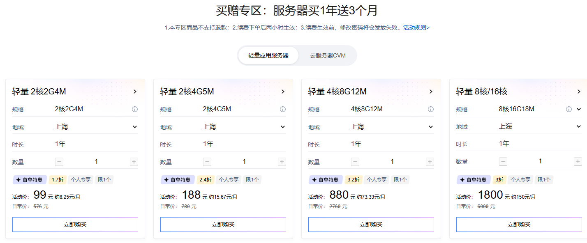
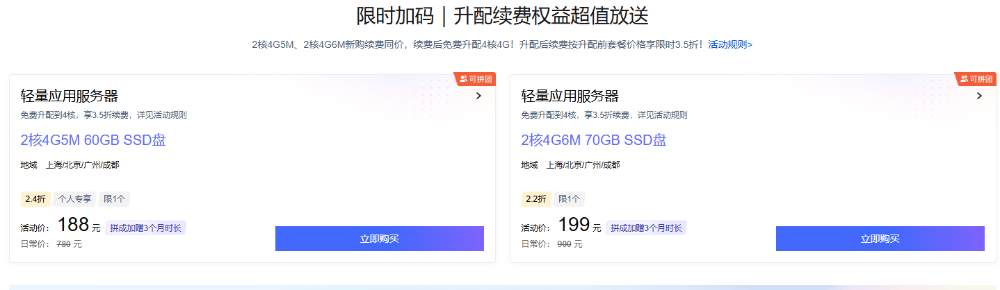

> 先说结论：今年双 11，腾讯云轻量应用服务器有两场值得认真看的活动——「买一年送 3 个月」（2核2G 99 元、2核4G 188 元）和「限时加码：新购续费同价 + 免费升配 4 核 + 多次 3.5 折续费」。要长持的人走第二条，而且**顺序是钥匙：先新购、再同价续费、最后免费升配 4 核** ——顺序反了，续费就按 4 核的价格算。活动截止 2026 年 11 月 30 日，售完即止。

一年一度的双十一，云服务器确实是全年最大的优惠窗口。但和买东西不一样，服务器是“买一次、用很久、续费好几年”的东西——真正让人纠结的从来不是“有没有便宜”，而是：该买什么配置、买多长时间、第二年续费贵不贵、买回来能不能撑住自己想跑的东西。

这篇就把这两件事一次讲完：前半段拆双 11 的两场活动怎么选、长持成本怎么算（重点讲清**续费和升配的先后顺序** ，这一步错了要多花钱）；后半段是我自己拿到一台新轻量服务器后必做的 5 件事。文中的活动链接是我的推广链接（[买赠专区](https://curl.qcloud.com/2tb8PzJe)、[限时加码](https://curl.qcloud.com/OuqlLFIH)、[同价续费](https://curl.qcloud.com/Z2SelzKW)），通过它下单价格不变，我会有少量佣金；价格与规则以官方活动页面实时显示为准。

## 一、先搞清楚：双 11 的便宜，便宜在哪

云服务器的价格由几部分组成：实例规格（CPU/内存）、磁盘、带宽/流量、计费时长。双 11 的优惠基本就作用在这四块上，常见形态有四种：

  * **新用户首单折扣** ——力度最大，比如这次的 2核4G5M 常态 780 元/年，活动价 188 元。门槛明确：个人专属、每档限购 1 台。

  * **限时秒杀** ——价格更低、库存有限，适合能盯着点的人。

  * **代金券/满减券** ——面额诱人但都有门槛（限产品、限新购、满减），结算页看最终价格最靠谱。

  * **续费与升级优惠** ——最容易被忽略、却最影响总成本的一项。**很多低价机是“首年特价”，第二年原价续费直接翻倍。** 所以下单前务必确认续费价。

一句话总结：双 11 的便宜是真的，但便宜通常只发生在第一年——除非你选的活动本身就带“续费同价/续费折扣”资格。这正是今年轻量这两场活动的价值所在。

## 二、两场活动怎么选：先看表格，再对号入座

第一场是「买赠专区」：买 1 年送 3 个月，四档规格：

型号| 活动价| 折扣| 折合月均| 日常价  
---|---|---|---|---  
轻量 2核2G4M| 99 元/年| 1.7 折| ≈8.25 元/月| 576 元  
轻量 2核4G5M| 188 元/年| 2.4 折| ≈15.67 元/月| 780 元  
轻量 4核8G12M| 880 元/年| 3.2 折| ≈73.33 元/月| 2760 元  
轻量 8核16G18M| 1800 元/年| 3 折| ≈150 元/月| 6000 元  
  
专区入口：[买一年送 3 个月专区](https://curl.qcloud.com/2tb8PzJe)（含轻量应用服务器和云服务器 CVM 两个标签页）。下单页写明的三条规则要记牢：本专区商品**不支持退款** ；**续费在下单两小时后生效** ；续费生效前修改密码会导致发放失败。

第二场是「限时加码」：2核4G5M 和 2核4G6M 两个型号新购续费同价，**拼团下单加赠 3 个月时长** ，配合「免费升配 4 核」和「多次 3.5 折续费」，是本次长持成本最低的玩法。限时加码入口：[免费升配 2核变 4核、拼团送 3 个月、多次续费 3.5 折](https://curl.qcloud.com/OuqlLFIH)。

新购套餐| 活动价| 拼团加赠| 升配后| 续费价（3.5 折）  
---|---|---|---|---  
2核4G5M 60GB SSD| 188 元（2.4 折，日常 780 元）| +3 个月时长| 4核4G5M| 273 元/年（日常 700 元）  
2核4G6M 70GB SSD| 199 元（2.2 折，日常 999 元）| +3 个月时长| 4核4G6M| 315 元/年  
  
## 三、重点：顺序错了要多花钱——新购、续费、升配的正确姿势

这套组合最关键的一点：**「新购续费同价」只对 2核4G 的套餐成立，免费升配要放在同价续费之后。**

正确的四步：

  1. **新购** 2核4G5M，188 元（拼团加赠 3 个月，实际用 15 个月）；

  2. **先同价续费** ：通过[同价续费入口](https://curl.qcloud.com/Z2SelzKW)，按 188 元/年续 1 年——此时实例还是 2核4G，享受的是 2核4G 的同价；

  3. **续费完成后，再免费升配** 到 4核4G5M（0 元，控制台一键，数据不迁移）；

  4. **之后每年按 3.5 折续费** （273 元/年，可多次）。

为什么顺序不能反：如果你先升配到 4 核再续费，续费就按升配后的价格体系算，每年 273 元起步；而先以 2核4G 的同价续费、再升配，你用 **188 元/年** 的成本享受的已经是 4 核的算力。同样是这台机器，顺序对了每年省 85 元。

**免费升配的资格口径也要看清** （不是所有 2核4G 都支持）：

  * 只有**中国境内地域** 支持免费升配，境外地域不支持；

  * 仅限入门型两档：2核4G 60G 系统盘 / 5M 带宽 / 500G 月流量包套餐，可升配至 4核4G 60G 系统盘 / 5M 带宽 / 500G 月流量包；2核4G 70G 系统盘 / 6M 带宽 / 600G 月流量包套餐，可升配至 4核4G 70G 系统盘 / 6M 带宽 / 600G 月流量包；

  * 其他套餐类型（如通用型、存储型）不支持免费升配。

## 四、长持成本账：4 年 922 元用 4核4G

按正确顺序走完 2核4G5M 全程的账（拼团口径）：

阶段| 操作| 支出| 手里是什么  
---|---|---|---  
第 1 年（实际 15 个月）| 拼团新购 2核4G5M| 188 元| 2核4G  
第 2 年| **先同价续费** （还是 2核4G 的价）| 188 元| 2核4G  
续费后| **免费升配**|  0 元| 4核4G5M  
第 3~4 年| 3.5 折续费 ×2（273 元/年）| 546 元| 4核4G5M  
合计| —| ≈922 元| 4核4G5M 用 4 年，年均约 230 元  
  
对比一下错误顺序（先升配再续费，全部按 273 元/年）：4 年要 188 + 273×3 = 1007 元。**一个顺序差异，4 年差出 85 元** ——这篇文章最值钱的就是这一段。

补一句公道话：如果嫌折腾，先升配后按 273 元/年续费也是好价格，只是没有把同价续费的资格用满而已。

## 五、三种人三种买法

  * **年抛党（只打算用一年）：** 直接蹲首单价，188 元的 2核4G（拼团还多 3 个月）就是目的地，不用纠结升配和续费。

  * **长持党（一用三五年）：** 严格按第三节的顺序走——新购 → 同价续费 → 免费升配 → 3.5 折续费，四步一步都别反。

  * **重负载（数据库/小程序后端/多服务）：** 直接看 4核8G12M 880 元/年（3.2 折）和 8核16G18M 1800 元/年（3 折），买赠专区里都有。

需要 AI 应用部署思路的可以配合[《AI 焕新：上云还是自己部署》](https://www.ya0.cn/archives/ai-huanxin-cloud-vs-selfhosted)一起看；手里有阿里云的也可以对比下[阿里云 99 元计划的续费账](https://www.ya0.cn/archives/aliyun-99-ecs-extended-2029)，两家加起来一年也就几百块。

## 六、开箱后我必做的 5 件事

便宜不是理由，能用才是。服务器到手，安全基线先搭好，下面是我每台新机器的标准动作。

**1\. 换密钥、关掉密码登录**
    
    
    ssh-keygen -t ed25519 -C "me@lighthouse"
    ssh-copy-id -i ~/.ssh/id_ed25519.pub root@<公网IP>
    
    sed -i 's/^#\?PasswordAuthentication.*/PasswordAuthentication no/' /etc/ssh/sshd_config
    sed -i 's/^#\?PermitRootLogin.*/PermitRootLogin prohibit-password/' /etc/ssh/sshd_config
    systemctl restart sshd

**2\. 系统防火墙 + fail2ban**

轻量服务器有两层防火墙：控制台安全组和系统内 ufw。很多人只配了一层，结果端口一直连不上，或者反过来裸奔——两层都要检查。
    
    
    apt update && apt install -y ufw fail2ban
    ufw allow 22/tcp && ufw allow 80,443/tcp
    ufw --force enable

**3\. 开 BBR**

5M 小带宽跑高延迟链路时，BBR 的提升相当明显，一行内核参数的事：
    
    
    cat >> /etc/sysctl.conf <<'EOF'
    net.core.default_qdisc = fq
    net.ipv4.tcp_congestion_control = bbr
    EOF
    sysctl -p && sysctl net.ipv4.tcp_congestion_control

**4\. 加 2G swap 兜底**

4G 内存编译项目、跑 MySQL 8 偶尔会抖，加个 swap 防止 OOM 直接杀进程：
    
    
    fallocate -l 2G /swapfile && chmod 600 /swapfile
    mkswap /swapfile && swapon /swapfile
    echo '/swapfile none swap sw 0 0' >> /etc/fstab

**5\. 先打一个快照，再开始折腾**

环境搭好、跑通第一个服务之后，立刻在控制台打一个快照。以后装新东西、改配置出问题，一键回滚，比任何“恢复教程”都管用。

## 写在最后

双 11 是一个“价格窗口”，不是“决策依据”。188 元的 2核4G（可 0 元升配 4 核）是今年最值得看的个人配置，但它值不值，取决于你有没有想清楚拿它做什么。想清楚了，入口都在这里：[买一年送 3 个月专区](https://curl.qcloud.com/2tb8PzJe)、[限时加码（新购续费同价 + 免费升配）](https://curl.qcloud.com/OuqlLFIH)、[同价续费入口](https://curl.qcloud.com/Z2SelzKW)。11 月 30 日截止，售完即止。

买完不知道练什么？[《第一台腾讯云服务器怎么买最省》](https://www.ya0.cn/archives/tencent-cloud-buying-guide)、[《一行代码自动续签 SSL 证书》](https://www.ya0.cn/archives/ssl-updata)、[《AI 应用上云还是自己部署》](https://www.ya0.cn/archives/ai-huanxin-cloud-vs-selfhosted)都是现成的上手内容。有问题评论区见。

_声明：文中活动链接为腾讯云推广链接，通过链接下单不影响你的价格。各活动规则、价格和库存会实时调整，具体以官方活动页面当日说明为准。_
