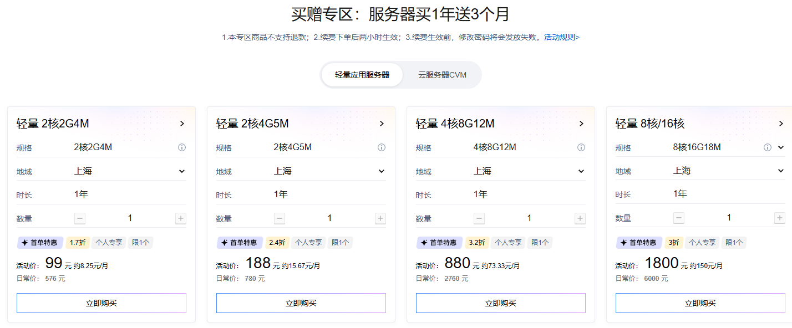
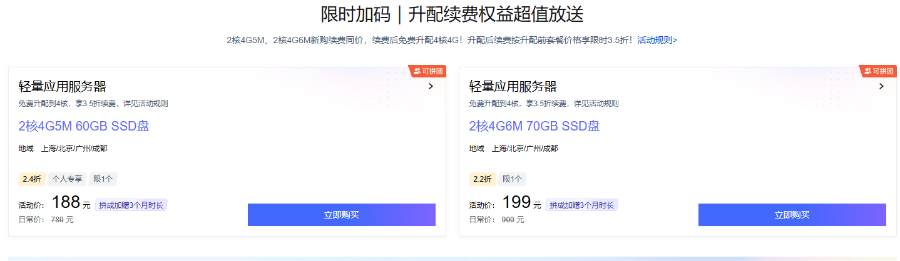

> 先说结论：如果你是自部署了一堆东西的开发者，今年双 11 腾讯云轻量里，**2核4G6M 70GB SSD** 这档比 188 元的 5M 档更值得看——199 元/年（2.2 折，日常 999 元），拼团加赠 3 个月，新购续费同价一次（第二年还是 199），之后 0 元升配 4核4G6M、多次 3.5 折续费（315 元/年）。前两年 398 元，四年 1028 元用 4核4G6M，年均 257。两个顺序别搞反：先同价续费、后免费升配；活动截止 2026 年 11 月 30 日，售完即止。

上一期写了 [188 元的 2核4G5M 档](https://www.ya0.cn/archives/tencent-lighthouse-double11-2026)，评论区被问得最多的是一句话：「我在上面跑 Docker、Git、定时构建，60G 盘和 5M 带宽会不会紧？」——所以这篇单独讲**开发者档：2核4G6M + 70GB SSD + 600G 月流量** ，199 元/年那档，配置比 5M 档多出的东西，恰好都长在开发者的痛点上。声明：文中链接是我的推广链接，通过它下单价格不变，我会有少量佣金；价格与规则以官方活动页面实时显示为准。

## 一、先看配置：多出来的 1M 带宽、10G 磁盘，对开发者意味着什么

和 188 元的 5M 档相比，199 元这档多了三样东西，逐个翻译成开发者语言：

  * **6M 带宽（750 KB/s 出方向）：** 入方向的下载（npm install、拉镜像、apt）不走这个出带宽，所以构建速度不受它影响；出方向是给别人访问的——API 响应、页面、webhook 回调，750 KB/s 对 JSON 接口和常规页面绰绰有余，演示站也不会一开就卡。

  * **70GB SSD（比 5M 档多 10GB）：** Docker 镜像层、构建产物、日志轮转、数据库增长，这些是开发机上吃得最快的空间。系统加基础环境吃掉 8-10G 之后，60G 盘半年就让人开始清理 Docker，70G 多出的余量就是「少折腾」三个字。

  * **600G/月流量（比 5M 档多 100G）：** 按 750 KB/s 满打满算也用不完，但峰值流量月份不用盯着仪表盘心慌。

4G 内存是两档共同的点：跑自部署服务足够，跑重编译会有点抖——所以本文第六节的 swap 不是可选项，是必做项。

## 二、前两年 199 元怎么来的：新购 + 同价续费

第一场「买赠专区」四档规格（2核2G4M 99 元、2核4G5M 188 元、4核8G12M 880 元、8核16G18M 1800 元）可以对照，但开发者档的主角在第二场「限时加码」里：

阶段| 操作| 价格| 说明  
---|---|---|---  
第 1 年| 新购 2核4G6M 70GB SSD（拼团加赠 3 个月，实际 15 个月）| 199 元| 2.2 折，日常 999 元  
第 2 年| 同价续费（此时实例还是 2核4G6M）| 199 元| 新购续费同价一次  
同价续费后| 免费升配到 4核4G6M| 0 元| 控制台一键，数据不迁移  
第 3 年起| 3.5 折续费，可多次| 315 元/年| 按升配前套餐价 900 元 × 3.5 折  
  
两个入口：限时加码（新购+升配权益）<https://curl.qcloud.com/OuqlLFIH>，买赠专区对照<https://curl.qcloud.com/2tb8PzJe>。同价续费的入口在<https://curl.qcloud.com/Z2SelzKW>，注意口径：**同价续费资格每个配置全网（含其他活动页面）限购 1 次、续费 1 次** ——这个资格要用在 2核4G6M 的刀刃上，别拿去续别的。

## 三、顺序别搞反：先同价续费，后免费升配

这是整个玩法里最容易踩的坑，单独拎出来说：**「新购续费同价」只对 2核4G6M 的套餐成立。如果你手快先把实例升配到 4 核，第二年的续费就按升配后的价格体系算，199 元的同价资格直接作废。**

  1. 新购 2核4G6M，199 元（拼团加赠 3 个月）

  2. **先同价续费** ：通过<https://curl.qcloud.com/Z2SelzKW>按 199 元/年续 1 年，此时实例还是 2核4G6M

  3. **续费完成后，再免费升配** 到 4核4G6M（0 元，控制台一键，数据不迁移）

  4. **之后每年按 3.5 折续费** （315 元/年，可多次）

算一笔顺序账：先续费后升配，第二年 199 元用 4核4G6M；先升配后续费，第二年 315 元起。一个顺序，差 116 元——而且这个资格第二年还能继续按 3.5 折（315 元）续，长持成本被压在整个活动期里。

## 四、免费升配的资格口径（不是所有 2核4G 都支持）

  * **地域：** 只有中国境内地域支持免费升配，境外地域不支持；

  * **套餐：** 仅限入门型两档——2核4G 60G 系统盘 / 5M 带宽 / 500G 月流量包 → 4核4G 60G 系统盘 / 5M 带宽 / 500G 月流量包；2核4G 70G 系统盘 / 6M 带宽 / 600G 月流量包 → 4核4G 70G 系统盘 / 6M 带宽 / 600G 月流量包；

  * **不支持：** 通用型、存储型等其他套餐类型不支持免费升配。

下单前对一眼自己的套餐是不是上面两档，别默认「2核4G 都能升」。

## 五、四年账：1028 元用 4核4G6M，年均 257

阶段| 支出| 手里是什么  
---|---|---  
第 1 年（15 个月）| 199 元| 2核4G6M 70GB  
第 2 年| 199 元（同价续费）| 2核4G6M 70GB  
第 2 年续费后| 0 元| 4核4G6M 70GB  
第 3~4 年| 315 元/年 ×2| 4核4G6M 70GB  
合计 ≈1028 元| —| 4核4G6M 用 4 年，年均 257 元  
  
和 5M 档（四年 922 元、500G 流量）对比：多花的 106 元，买到的是 +1M 带宽、+10GB 磁盘、+100G/月流量。对放静态博客的人来说不值，对常年跑 Docker 和构建的开发者来说，10GB 磁盘余量半年就回本了。

## 六、开箱后我必做的 5 件事（开发者版）

**1\. 密钥登录 + 关密码：** 新机器第一件事，别让爆破脚本对着密码试。
    
    
    ssh-keygen -t ed25519 -C "me@dev"
    ssh-copy-id -i ~/.ssh/id_ed25519.pub root@<公网IP>
    sed -i 's/^#\?PasswordAuthentication.*/PasswordAuthentication no/' /etc/ssh/sshd_config
    sed -i 's/^#\?PermitRootLogin.*/PermitRootLogin prohibit-password/' /etc/ssh/sshd_config
    systemctl restart sshd

**2\. ufw + fail2ban 双层防火墙：** 控制台安全组和系统内 ufw 是两层，都要检查；22 和 80/443 放行，其他默认拒。
    
    
    apt update && apt install -y ufw fail2ban
    ufw allow 22/tcp && ufw allow 80,443/tcp
    ufw --force enable

**3\. 开 BBR：** 6M 小水管跑 API 和 git 操作，BBR 对高延迟链路提升明显。
    
    
    cat >> /etc/sysctl.conf <<'EOF'
    net.core.default_qdisc = fq
    net.ipv4.tcp_congestion_control = bbr
    EOF
    sysctl -p

**4\. 2G swap：** 4G 内存跑 docker build 会顶到天花板，swap 防止 OOM 杀进程——这条对开发者档尤其重要，构建高峰全靠它兜底。
    
    
    fallocate -l 2G /swapfile && chmod 600 /swapfile
    mkswap /swapfile && swapon /swapfile
    echo '/swapfile none swap sw 0 0' >> /etc/fstab

**5\. 跑通第一个服务就打快照：** 后面装任何东西出问题，一键回滚，比重装省半小时起步。

## 常见问题

### 只买一年，有必要参与升配吗？

有必要。升配 0 元，第二年起 4 核算力白拿；就算第二年不续费，第一年用的也是 4核4G6M。唯一顺序要求：如果第二年要同价续费，先续费再升配。

### 和 188 元的 5M 档怎么选？

放静态内容、跑轻服务：5M 档省 11 元/年；跑 Docker、构建、数据库这类吃磁盘和 IO 的：6M+70GB 档。差价四年 106 元，按需求选，不按折扣力度选。

### 3.5 折续费可以续几年？

活动期内可多次续费、每次一年，具体能锁到哪一年以活动页规则为准。按今年活动节奏，把未来两三年锁住是没问题的。

### 6M 带宽够跑生产服务吗？

750 KB/s 出方向，页面和 API 足够；真遇到大流量，正确姿势是静态资源上 CDN，而不是盲目升带宽——这也是轻量服务器「固定带宽+大流量包」设计对开发者的友好之处。

## 写在最后

双 11 的价格窗口一年一次，但服务器的选型逻辑是长期的：配置对不对、续费贵不贵、数据安不安全，这三件事想清楚了，再看促销页就不晕了。本篇的主角 2核4G6M 70GB，前两年 398 元、升配后 4核4G6M、之后 315 元/年——需要的话入口在这里：<https://curl.qcloud.com/OuqlLFIH>（限时加码）、<https://curl.qcloud.com/Z2SelzKW>（同价续费）、<https://curl.qcloud.com/2tb8PzJe>（买赠专区）。11 月 30 日截止。

相关阅读：[《188 元 2核4G5M 档：同价续费与升配顺序详解》](https://www.ya0.cn/archives/tencent-lighthouse-double11-2026)、[《第一台腾讯云服务器怎么买最省》](https://www.ya0.cn/archives/tencent-cloud-buying-guide)、[《一行代码自动续签 SSL 证书》](https://www.ya0.cn/archives/ssl-updata)。
