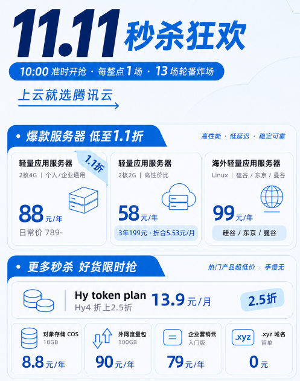
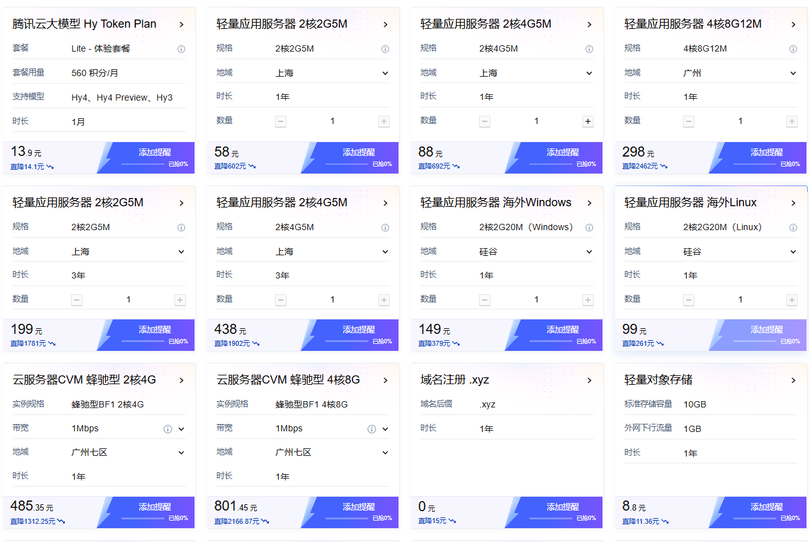

> 先说结论：今年双 11 腾讯云的主题是「让每一个 Agent 都跑在云上」，爆款轻量低至 1.1 折——**2核4G5M 88 元/年** 、**2核2G5M 58 元/年** 、**2核2G 三年 199 元** 。10:00 开抢，每整点 1 场共 13 场。三个判断：① 大多数人的最优解是 **2核4G 88 元/年** ，不是三年档；② 三年 199 元买的不是「最低单价」，而是「三年不涨价」的确定性（58×3=174 其实更便宜）；③ 地域是硬约束——2核2G/2核4G 是上海、4核8G 是广州、海外机是硅谷，下单前必须确认。

前两年写过 双 11 的长持玩法，讲的是"新购 → 同价续费 → 免费升配"那套组合拳；这次 11.11 秒杀专场的规则不一样：**整点开抢、每场限量、售完即止** ，而且不少档位是"一次性低价"，不参与续费同价。所以这篇不重复讲续费套路，只做一件事：**把每个档位该不该买，算清楚** 。活动入口：[腾讯云 11.11 秒杀狂欢](https://curl.qcloud.com/OuqlLFIH)。价格与库存以官方活动页实时显示为准。

## 一、活动机制：13 场整点秒杀，不是挂着随便买

这次秒杀是**整点开抢** 的形式，不是随时点随时有：

  * **开抢时间：** 10:00 首场，从 10 点到晚上 10 点，每整点 1 场，共 **13 场**

  * **每场库存：** 独立放量，热门 SKU 常见几十秒内「已抢光」，下一场重新放

  * **抢购方式：** 活动页对心仪的卡片点「添加提醒」，到点刷新抢

所以准备动作比手速更重要：**提前登录、完成实名认证、绑好支付方式** 。很多人不是没抢到，是抢到之后卡在付款页——秒杀订单有时限，卡住就自动释放了。活动入口：[腾讯云 11.11 秒杀狂欢](https://curl.qcloud.com/OuqlLFIH)。

> 官方海报：10:00 准时开抢，每整点 1 场，13 场轮番炸场；爆款服务器低至 1.1 折。

## 二、全档位清单（按活动页实拍整理）

> 活动页商品卡片实拍：规格、地域、时长、活动价与划线价一目了然。

把 12 个档位整理成一张表，**地域和时长这两列建议重点看** ——它们是下单后改不了的：

商品| 规格 / 地域| 时长| 活动价| 直降| 日常价  
---|---|---|---|---|---  
轻量应用服务器| 2核2G5M · 上海| 1 年| **58 元**|  602 元| 660 元  
轻量应用服务器| 2核4G5M · 上海| 1 年| **88 元**|  692 元| 780 元  
轻量应用服务器| 4核8G12M · 广州| 1 年| **298 元**|  2462 元| 2760 元  
轻量应用服务器| 2核2G5M · 上海| 3 年| **199 元**|  1781 元| 1980 元  
轻量应用服务器| 2核4G5M · 上海| 3 年| **438 元**|  1902 元| 2340 元  
海外轻量（Linux）| 2核2G20M · 硅谷| 1 年| **99 元**|  261 元| 360 元  
海外轻量（Windows）| 2核2G20M · 硅谷| 1 年| **149 元**|  379 元| 528 元  
CVM 蜂驰型| BF1 2核4G 1Mbps · 广州七区| 1 年| **485.35 元**|  1312.25 元| 1797.60 元  
CVM 蜂驰型| BF1 4核8G 1Mbps · 广州七区| 1 年| **801.45 元**|  2166.87 元| 2968.32 元  
Hy Token Plan| Lite 体验套餐 · 560 积分/月| 1 月| **13.9 元**|  14.1 元| 28 元  
对象存储 COS| 标准存储 10GB + 1GB 下行| 1 年| **8.8 元**|  11.36 元| 20.16 元  
.xyz 域名| 首单注册| 1 年| **0 元**|  15 元| 15 元  
  
另外活动页还有 **外网流量包 100GB（90 元/年）** 、**企业营销云入门版（79 元/年）** 、**CloudBase 96 元/年** 等品类，以及 **Answerbit 限时特惠** ，价格以页面实时显示为准。

## 三、核心问题：三年 199 元值不值？把账算给你看

这是全篇最该讲清楚的一段。很多同类文章都在说"199 元三年、折合 5.53 元/月、超划算"，但很少有人把**另一条路** 摆出来对比——如果你每年都买一年档呢？

**以 2核2G 为例，三条路的三年总支出：**

方案| 三年总支出| 折算月均| 说明  
---|---|---|---  
一次买三年 **199 元**|  199 元| 5.53 元/月| 锁价三年，不受后续调价影响  
一年档 58 元 × 买三次| **174 元**|  4.83 元/月| 前提：每年都能抢到 58 元的秒杀价  
一年档 + 按日常价续费 2 次| 58 + 660×2 = 1378 元| 38.3 元/月| 秒杀价通常只针对首购，续费回原价  
  
看清楚了吧：**199 元并不是"绝对最低价"** ——如果你确定每年都能用 58 元抢到一台新的，三年只要 174 元，比三年档还便宜 25 元。

那三年档的价值在哪？**在于它把这 25 元的差价，换成了三年的确定性** ：不用担心明年秒杀还有没有 58 元、不用每年重新比价、不用到期前腾挪数据。对"只想买一次、三年不折腾"的人来说，25 元买个安心，非常值。

**但 2核4G 的情况完全不同：**

方案| 三年总支出| 对比  
---|---|---  
一次买三年 **438 元**|  438 元| —  
一年档 88 元 × 买三次| **264 元**|  比三年档便宜 **174 元**  
  
同样是三年档，2核4G 的溢价高达 174 元（66%）。所以我的建议很明确：

  * **要锁价不折腾 → 买 2核2G 三年 199 元** ，25 元的溢价买三年安心，划算。

  * **要配置更好 → 买 2核4G 一年 88 元** ，三年档那 174 元的溢价不划算；一年后到期再比价，说不定明年还有更低的价。

  * **别买 2核4G 三年 438 元** ——除非你特别在意"三年不用管"，否则这是本次性价比最差的一档。

（说明：上面"一年档买三次"的前提是每年都能抢到秒杀价，这在现实中不完全可控——13 场限量、热门档秒没。如果你的时间成本高，这个不确定性本身就是买三年档的理由。）还没下单的，入口在这：[腾讯云 11.11 秒杀狂欢](https://curl.qcloud.com/OuqlLFIH)。

## 四、按场景选：六种人六种买法

你的情况| 推荐档位| 理由  
---|---|---  
放个静态博客 / 小站 / 练手| **2核2G 58 元/年**|  够用、便宜、灵活，明年不合适就换  
不想每年折腾续费| **2核2G 三年 199 元**|  锁三年，25 元买确定性  
跑 Docker / 数据库 / Java 服务| **2核4G 88 元/年**|  本次性价比之王，1.1 折  
中型项目 / 多容器 / 小程序后端| **4核8G12M 298 元/年**|  广州节点，2760 元日常价打 1.1 折  
外贸站 / 海外用户| **海外轻量 99 元/年（Linux）**|  硅谷 20M 大带宽，免备案  
需要完整 CVM 能力| **CVM 蜂驰型 485.35 元/年起**|  广州七区，1Mbps 带宽，可弹性变配  
  
**两个必须提醒的地域细节：**

  * 国内轻量中，**2核2G / 2核4G 是上海** 地域，**4核8G 是广州** 地域，CVM 是**广州七区** ——秒杀下单时地域就定了，后续迁移很麻烦，先想清楚你的用户在哪个区域。

  * 海外机目前卡片显示的是**硅谷** 节点（海报上写有硅谷/东京/曼谷可选，以页面实际可选项为准），面向东南亚用户的建议先确认延迟再下单。

## 五、顺手带的低价品：哪些真的值得加购

### Hy Token Plan：13.9 元/月

Lite 体验套餐，560 积分/月，支持 **Hy4、Hy4 Preview、Hy3** 模型，时长 1 个月。如果你在接大模型 API 做 Agent、做内容生成，13.9 元把链路先跑通，比自己搭环境划算得多——活动页写的「Hy4 折上 2.5 折」也是这次的重点之一。

### .xyz 域名：首单 0 元

一年免费，续费十几块。个人博客、练手项目、临时跳转域名，这是本次最"闭眼入"的一项，限首单。

### 对象存储 COS：8.8 元/年

标准存储 10GB + 外网下行 1GB。配合轻量服务器做图床、做站点备份很合适——我自己的博客就是"服务器只跑程序，静态资源丢对象存储"，带宽压力能小一大截。

### 外网流量包 100GB：90 元/年

轻量流量超了会限速或额外计费，做活动、发内容有流量高峰的话，提前备一个比事后补划算。

## 六、抢购实战：13 场怎么抢到手

  1. **提前 5 分钟进页面：** 10:00、11:00、12:00……整点放量，提前进页面并刷新，比准点才打开快得多。

  2. **先做完三件准备：** 登录、实名认证、绑定支付方式——这三步任何一步卡住，抢到也会丢单。

  3. **认准卡片上的时长：** 「2核2G5M 1 年 58 元」和「2核2G5M 3 年 199 元」是**两个独立商品** ，不是同一 SKU 的时长切换，别点错。

  4. **没抢到就等下一场：** 13 场机会，心态放平；热门档可以先用「添加提醒」占位。

  5. **下单前确认地域：** 秒杀商品通常**不支持退款、不支持降配** ，地域选错只能认。

## 常见问题

### 2核2G 到底能跑什么？会不会不够？

静态博客（Halo / Hexo / WordPress 单站）、轻量 API、定时任务、监控面板、Git 私服都没问题。**会不够的情况：** Docker Compose 一次起五六个容器、MySQL 8 + 应用同机、Java 服务（JVM 本身吃内存）——这些直接上 2核4G 或 4核8G，2核2G 会遇到 OOM。

### 5M 带宽够用吗？

5 Mbps ÷ 8 = **640 KB/s** 。1MB 的页面首屏约 1.6 秒，博客和 API 完全够。不够的场景是图片/视频直链、大文件下载——正确的做法是把静态资源放对象存储走 CDN，而不是盲目升带宽。

### 秒杀买的机器，明年续费多少钱？

按日常价续：2核2G 660 元/年、2核4G 780 元/年。所以"一年档 + 原价续费"这条路三年要 1378 元，这也是为什么"锁三年"对不想折腾的人很值——但具体续费价以控制台显示为准。

### 海外机和国内机怎么选？

国内机（上海/广州）需要 ICP 备案，访问速度快；海外机（硅谷）免备案、20M 大带宽，适合外贸站和海外用户。如果你的用户 90% 在国内，别为了省事选海外——链路绕一圈，体验掉得比省下的钱多。

### 抢到的价格能开票、能退款吗？

能开票（企业认证）。退款要看具体商品规则，秒杀类通常不支持无理由退款，下单前确认地域和配置。

## 写在最后

今年 11.11 秒杀的核心，不是"哪个最便宜"，而是**你要的是"灵活"还是"确定"** ：灵活选一年档（58 / 88 元），确定选三年档（199 元），预算充足上 4核8G（298 元）。至于 2核4G 三年 438 元那档，除非你特别看重"三年不管"，否则我不推荐。

入口在这里：[腾讯云 11.11 秒杀狂欢](https://curl.qcloud.com/OuqlLFIH)。10:00 开抢，每整点 1 场共 13 场，热门档位几十秒就没，提前把账号和支付准备好。

相关阅读：《双 11 轻量：2核4G6M 前两年 199 元，续费与升配顺序详解》、《188 元 4核4G 轻量：怎么买、值不值、开箱必做 5 件事》、《第一台腾讯云服务器怎么买最省》、《一行代码自动续签 SSL 证书》。

本文价格均来自活动页展示（含划线价/直降金额），活动规则、价格和库存可能实时调整，具体以官方活动页当日说明为准。
