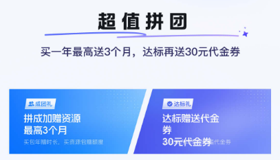
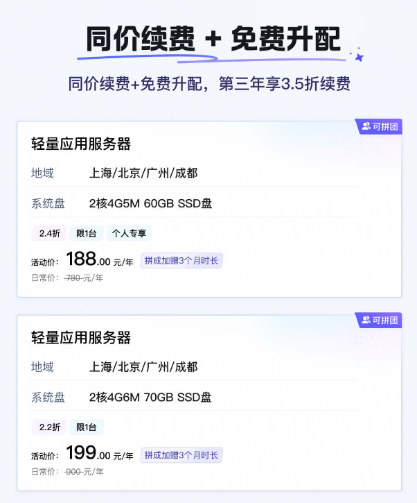

> 188 元一年，折下来一天五毛钱。腾讯云年度大促的轻量应用服务器，2核4G5M、60GB SSD 盘，日常价 780 元，现在打 2.4 折，拼团再送 3 个月。更关键的是第二年续费同价，续完还能免费升配到 4核4G。建站、跑 Agent、开游戏服，这一档都够用。

促销季的云活动页总是花花绿绿，规则绕得像道数学题。这篇不堆参数，只讲三件事：卖的是什么、三年花多少钱、你适不适合买。

## 一、卖的是什么：两档机器，差 11 块钱

[轻量应用服务器](https://cloud.tencent.com/act/cps/redirect?redirect=38900&cps_key=c5fe4c68b5e566ad91949bb842ce278c)可以理解成开箱即用的入门款云服务器，CPU、内存、带宽打包好，买了就能用。这次有两档：

| 2核4G5M| 2核4G6M  
---|---|---  
系统盘| 60GB SSD| 70GB SSD  
活动价| **188 元/年**| **199 元/年**  
折扣| 2.4 折（日常 780 元）| 2.2 折（日常 999 元）  
地域| 上海 / 北京 / 广州 / 成都| 上海 / 北京 / 广州 / 成都  
  
放博客、个人主页、小工具，5M 档够了。想多跑几个服务、多存点东西，加 11 块上 6M 档。两档都是个人专享，每人限 1 台。

## 二、拼团：买一年，最多送 3 个月

下单时选[拼团](https://cloud.tencent.com/act/cps/redirect?redirect=38900&cps_key=c5fe4c68b5e566ad91949bb842ce278c)，成团后加赠最长 3 个月时长；订单达标，再送一张 30 元代金券。成团和达标的条件，下单页面写得清楚。188 元那台拼成后相当于用 15 个月，每月 12 块多。

## 三、长期用，续费才是大头

云服务器有个老毛病：首年便宜，续费翻倍，不少人第二年只能换机器、迁数据。这次给的是另一条路：

  1. 第二年同价续费，还是 188 元；

  2. 续完免费升配 4核4G，不加钱；

  3. 第三年享[3.5 折续费](https://cloud.tencent.com/act/cps/redirect?redirect=38900&cps_key=c5fe4c68b5e566ad91949bb842ce278c)，按升配前套餐价 780 元算，一年 273 元。

**顺序别搞反** ：先续费，续完再升配。要是先升了配，那一次同价续费就用不上，第二年续费直接按 3.5 折算。

这么下来，前两年 376 元，第三年 273 元，一台 4核4G 的机器三年一共 649 元。

手里已经有机器的，活动里还有[续费专区](https://cloud.tencent.com/act/cps/redirect?redirect=38900&cps_key=c5fe4c68b5e566ad91949bb842ce278c)，多款指定机型也能享 3.5 折续费，可以翻翻自己那台在不在名单里。

## 四、你是不是该买

  * 想有个自己的博客、作品集：买，5M 档够用。

  * 在学 Linux、Docker，想找台随便折腾的机器：买，搞坏了重装，一年不到 200 块。

  * 想让 AI Agent、爬虫、自动化脚本全天在线：买。自己电脑一关机就断，云上不会，之前算过一笔电费账，可以看看。

  * 想和朋友开个游戏服：买，升配后有 4 核，比 2 核稳。

  * 只是觉得便宜：先想清楚拿它干嘛，闲置的服务器再便宜也是浪费。

## 五、下单前记住三件事

  * 地域选离你近的：上海、北京、广州、成都，买完不好改。

  * 拼团有时限，别拖到最后一天。

  * 开机先改密码、打快照，具体步骤可以看我之前写的开箱后必做的 5 件事。

## 活动入口

活动页面：<https://curl.qcloud.com/OuqlLFIH>

价格和规则以活动页实时显示为准。
