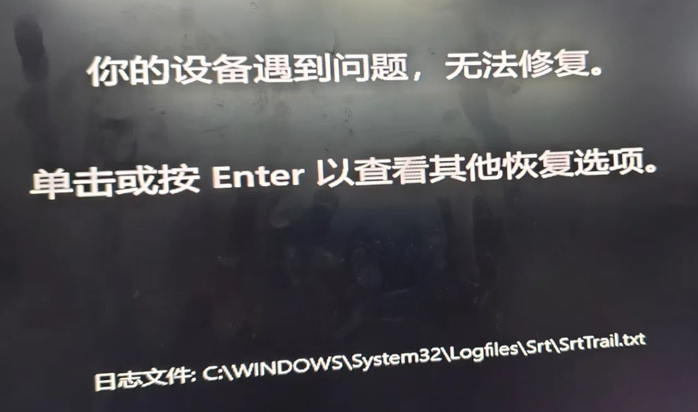

> 一台正常使用的办公电脑，重启后陷入"自动修复 → 失败 → 重启"死循环。硬盘拆到别的机器上能修复进系统，装回原机立刻复发。最后查明：硬盘没坏、系统没坏，是 **Secure Boot 的签名校验在后台断了信任链** ——BIOS 里把它关掉，机器直接复活。以下是完整排查过程和避坑清单，按这个顺序查，能少走很多弯路。

## 事情经过

员工反映电脑"比较卡"，整理了一些文件后重启，系统再也进不去了：开机反复自检，最后停在蓝屏提示"你的设备遇到问题，无法修复"，下方给出日志路径 `C:\WINDOWS\System32\Logfiles\Srt\SrtTrail.txt`。

排查中最关键的一个现象：**把硬盘拆下来接到另一台主机上，能正常修复并进入系统；装回原机，问题立刻复发。** 这个现象基本排除了硬盘损坏和系统文件损坏，把嫌疑指向原主机的固件环境。

## 五个坑，逐个说

### 坑一：以为是硬盘坏了

"无法修复"四个字很容易让人联想到硬盘故障。但换机测试是最快的判别方法：同一块盘在别的机器上一切正常，说明盘和系统都没问题，问题出在原机的硬件环境或固件设置。**手头有第二台机器的话，这一步值得最先做** ——五分钟就能把排查方向分成两半。

### 坑二：恢复 BIOS 默认设置，并没有用

原机 BIOS 恢复默认后，依然无法启动。这里有个容易误解的点：这台机器的 Secure Boot 从出厂就是开启状态，员工从未动过 BIOS——恢复默认并不会把"开"变成"关"，拦截照样发生。**问题从来不是"谁把开关打开了"，而是校验的信任链在后台断了。**

### 坑三：Secure Boot 一直开着，之前能进系统，为什么突然进不去（本例根因）

这是整件事最反直觉的地方，值得展开讲。Secure Boot 的工作方式是：开机时，主板固件用内置的受信任证书库去验证启动管理器（bootmgfw.efi）的数字签名。之前每次都能通过，说明签名和证书库是匹配的。

突然匹配不上了，一个常见原因是：**Windows 更新在后台更换了启动文件的签名证书（比如向新证书迁移），而主板固件里的证书库没有同步更新，不认识新签名。** 文件本身是微软合法签发的，但固件"不认"，校验失败，系统拒绝启动。整个过程完全静默——用户不需要懂 BIOS、不需要碰任何设置，一次正常的重启就能触发。

"整理文件"这个动作更像是导火索而不是根因：如果整理过程中触碰了引导分区或启动文件，或者重启时自动修复重写了启动配置，就可能让本已脆弱的信任链彻底断开。

### 坑四：死磕 SrtTrail.txt 日志，结果文件根本不存在

报错界面给了日志路径，但通过其他途径进系统后，那个文件并不存在。这说明自动修复在写入日志之前就中断了。**找不到这个文件不是意外，它本身就是"修复过程早期失败"的信号** ——不必在上面耗费时间，直接转向下一步。

### 坑五：忽略了"安全模式能进"这个重要线索

后续测试发现：安全模式、带网络的安全模式都能进，唯独正常模式不行。安全模式会跳过大部分第三方驱动和非必要服务，它能进，说明引导本身没坏，**问题出在正常启动路径上加载的某个组件** ——驱动冲突、近期更新、第三方服务或启动项。这个线索本可以把排查方向提前收窄很多。

## 本例的解法与通用排查顺序

本例的直接解法很简单：**BIOS 里把 Secure Boot 设为 Disabled，系统立即恢复正常启动。** 对没有特殊安全合规要求的办公机，这是最省事的方案。

如果想更系统地排查，建议按下面的顺序走：

  1. **换机测试硬盘** ：快速区分"盘的问题"和"机的问题"。

  2. **检查 Secure Boot 状态** ：暂时禁用，验证是否为安全启动拦截（本例即此）。

  3. **利用安全模式做干净启动** ：msconfig 勾选"隐藏所有 Microsoft 服务"后全部禁用，任务管理器禁用启动项，重启测试；能进再分批启用，定位具体软件。

  4. **系统修复命令** ：安全模式下以管理员运行 `sfc /scannow` 和 `chkdsk C: /f`。

  5. **检查近期更新与驱动** ：卸载最近装的 Windows 更新，回滚可疑驱动（显卡、安全软件驱动是重灾区）。

  6. **物理检查 M.2 硬盘** ：断电后重新插拔、清洁金手指，有条件换一个 M.2 插槽，排除接触不良。

  7. **保底方案** ：备份数据后重置系统（保留个人文件），让启动配置针对当前硬件重新生成。

## 避坑清单（速查版）

  * 先换机测硬盘，别急着判硬盘死刑。

  * Secure Boot 报错不一定是"被人打开了"，更可能是更新导致签名与固件证书库不匹配。

  * 恢复 BIOS 默认不等于解决问题——默认状态可能恰好就是拦截状态。

  * SrtTrail.txt 找不到不必死磕，那本身就是"修复早期失败"的信号。

  * 安全模式能进、正常模式不能进：优先怀疑第三方驱动、服务和近期更新。

  * 关 Secure Boot 是可用的临时方案；想重新开启，需要在 BIOS 里恢复/同步 Secure Boot 密钥库，并确认启动文件签名状态，操作前备份数据。

  * 动 BIOS 或插拔硬件前，务必关机断电。

## 写在最后

这次排查最大的教训是：**现象很吓人的故障，根因可能很安静** 。一次后台更新就能让信任链悄悄断裂，把一台好端端的机器变成"无法修复"。遇到这类死循环，先做换机测试和 Secure Boot 检查，往往几分钟能定位方向；安全模式能进的话，干净启动是性价比最高的下一步。

相关阅读：《Windows 无法进系统的一个原因》（同款"换机定位"思路的另一个案例）、《用 DiskGenius 备份还原系统分区》、《Ghost 恢复错误 25002 解决方法》。
