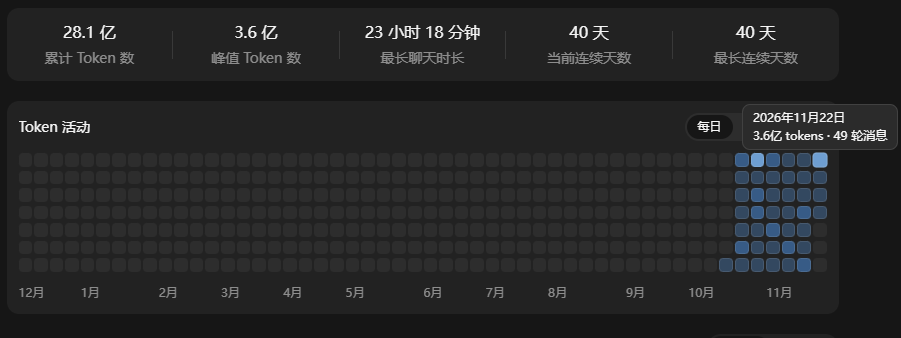
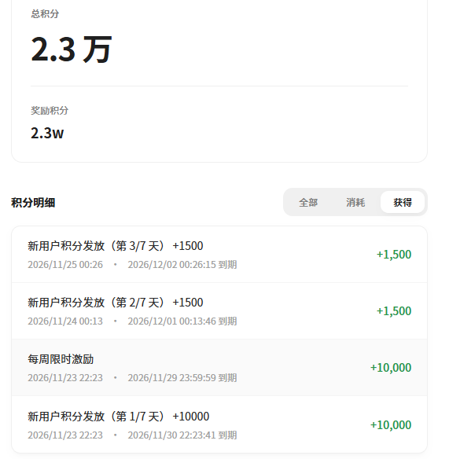

> 工作日 3 亿、周末 5 亿 token，转头又把 2.3 万积分塞进你账号。智谱这一轮「送」的力度，已经到了让人不好意思说自己缺额度的地步。

这篇记录一下这段时间用智谱的真实体感：token 多到什么程度、玩法怎么一波接一波、积分怎么领才不浪费，最后是刚上线的新活动入口。

## 一、先说送 token 这件事

前几周智谱搞活动：工作日送 3 亿 token，周末送 5 亿。这两个数单独看没什么感觉，念出来像新闻里的统计口径。可它是真的落到你账号里的。

于是普通人第一次有了那种感觉——**额度多到花不完** 。以前用模型像用流量，月底得算计着来；现在像家里水管忘关了，你只担心自己接不住。

我的用法很快就变了。晚上下重活，通宵挂着跑；给一个足够长的任务，让 Agent 自己干，干完自己把电脑关掉。我睡我的，它干它的，第二天早上开机看结果。搁以前这种跑法是要算成本的——跑一夜等于烧掉多少额度，心里得有个数。现在不用算了。

最爽的其实不是省了多少钱，是心态变了。以前开任务之前会先问一句：这个值不值得跑？现在想的是：**反正额度花不完，那就跑** 。这一句「那就跑」，值很多钱。

这是我这段时间的 Token 看板：**累计 28.1 亿，峰值 3.6 亿，最长一次聊了 23 小时 18 分钟，连续 40 天没断** 。右边那一列深蓝的格子，基本都是夜里挂机挂出来的。

## 二、玩法是一波接一波的

智谱从「牛来」那波模型热点开始，就一直没停过给玩法。一轮接一轮，节奏密得有点跟不上：你刚把上一波的额度消化完，下一波已经摆在面前了。

这些玩法看着散，其实是一条线：**先把 token 送够，让你敢用；再把积分送进来，让你天天来；最后用几个限时的名目，让你舍不得断。**

## 三、积分，也是随便用

上图是我账号里的积分：总积分 2.3 万，奖励积分 2.3 万——换句话说，**这 2.3 万全是发下来的** 。明细里能看清节奏：新用户第 1 天 +10000，第 2 天 +1500，第 3 天 +1500，中间还夹了一个每周限时激励 +10000。

我的建议是，**别省** 。它不像工资，像雨——下的时候你不接，过了就没了。上面每一条都写着到期时间，所以记得天天登录，别错过福利。

留意「第 1/7 天」「第 2/7 天」「第 3/7 天」这种写法：它不是一次发完，是按天连着发的。也就是说，天天登录不是一句客套话，**它是领钱的手续** 。

## 四、又来了

像「牛来」一样，福利来的时候，谁给的、为什么给、能领多久，一下子让人搞不清楚。搞不清楚没关系，先领。

现在又来了一波，原话是这么说的：**用智谱积分无上限！AutoClaw 积分风暴来袭，跟我一起用 AutoClaw 龙虾：GLM-5.4 尝新** 。

活动入口：[AutoClaw 积分风暴（点这里进去）](https://autoglm.zhipuai.cn/misc/autoclaw-invite?activity_id=autoclaw_fission&channel=fission&source_location=sidebar&target_app=autoclaw&target_app_version=2.3.0&os=win&IC=G8T3AX2Z)。天天登录，别错过发放日；新用户前 7 天和每周限时激励，各有各的到期时间。

## 写在最后

这波福利说白了就一句话：**大模型的日常使用成本，正在被厂商打到忽略不计** 。以前担心的是「额度够不够」，现在该琢磨的是「拿这些额度干点什么」——通宵挂任务、批量处理、把以前觉得「浪费」的想法都翻出来跑一遍。

额度是别人的，跑出来的结果才是自己的。
